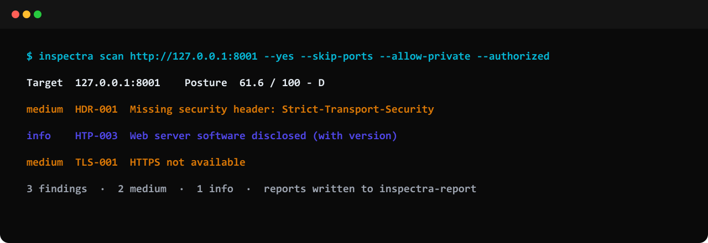

<div align="center">


</div>

One command, passive security assessment for authorized targets — and nothing more.

**What it does:** scans a target you own or are authorized to test; runs DNS, TLS, HTTP, headers, robots, directories, ports, and fingerprint checks; scores posture and emits JSON/Markdown/HTML/SARIF reports.

**What it does NOT do:** it is not an offensive tool, brute-forcer, or vulnerability database. It assesses what a target willingly exposes and explains what that means. No exploitation code anywhere in the codebase.

**Safe by design:** GET-only requests, timeouts everywhere, rate-limited opt-in directory checks, first-run authorization gate (`--authorized`), and private-IP blocking unless explicitly allowed (`--allow-private`).

---

[](.github/workflows/ci.yml)
[](pyproject.toml)
[](LICENSE)
[](pyproject.toml)
[](pyproject.toml)
[](pyproject.toml)
[](https://shashu123456.github.io/Inspectra/)

---

## Terminal demo



*Real output from `inspectra scan` against the committed replay fixtures — not a mockup.*

## How it works

Inspectra scans a target you own or are authorized to test through a bounded pipeline:


1. **Safety/SSRF gate** — DNS is resolved once and the IP is pinned; private/loopback/link-local/CGNAT addresses are blocked unless `--allow-private --authorized` is both present; HTTPS→HTTP downgrades and metadata endpoints are rejected.
2. **Checks** — DNS, TLS, HTTP, headers, robots, directories, ports, fingerprint, and context checks run with per-host politeness (max 2 in-flight) and degrade gracefully.
3. **Findings** — each check emits rule-id, title, severity, confidence, evidence, and an `evidence_hash`.
4. **Risk engine** — severity × confidence → posture score (0–100) with letter grade.
5. **Report** — JSON, Markdown, HTML, or SARIF output, with optional baseline diff (`--fail-on` fails CI only on new findings).

---

## Quick start

```bash
# 1. Install
pip install -e ".[dev]"

# 2. Scan an authorized target (first run shows the authorization agreement)
inspectra scan http://127.0.0.1:9999 --yes --skip-ports --allow-private --authorized --format html

# 3. Open the self-contained HTML report
start inspectra-report/report.html      # Windows
# open inspectra-report/report.html     # macOS/Linux
```

Reports land in `./inspectra-report/` (`report.json` always, plus your chosen format).

---

## Output formats

| Format | Description |
|--------|-------------|
| **JSON** | Always written. Machine-readable, stable schema, timezone-safe timestamps. |
| **Markdown** | Default human-readable format: severity headers, summary table, posture score. |
| **HTML** | Self-contained, polished report with inline CSS — no external assets. |
| **SARIF** | SARIF 2.1.0 for CI pipelines (GitHub Code Scanning compatible). |

```bash
inspectra scan http://127.0.0.1:9999 --yes --skip-ports --allow-private --authorized --format sarif -o report.sarif
```

---

## GitHub Action

Run Inspectra in CI and fail on new findings:

```yaml
name: inspectra
on: [push, pull_request]
jobs:
  scan:
    runs-on: ubuntu-latest
    steps:
      - uses: actions/checkout@v4
      - uses: actions/setup-python@v5
        with: { python-version: "3.11" }
      - run: pip install -e ".[dev]"
      - run: |
          inspectra scan http://127.0.0.1:9999 --yes --skip-ports --allow-private --authorized \
            --format sarif -o inspectra.sarif
      - uses: github/codeql-action/upload-sarif@v3
        with: { sarif_file: inspectra.sarif }
```

---

## Baseline diff (fail on new)

Save a baseline, then compare future scans against it — `--fail-on` exits non-zero only when new findings appear:

```bash
inspectra scan http://127.0.0.1:9999 --yes --skip-ports --allow-private --authorized \
  --save-baseline baseline.json
inspectra scan http://127.0.0.1:9999 --yes --skip-ports --allow-private --authorized \
  --baseline baseline.json --fail-on new
```

---

## Safety model

- Private-IP blocking: private/loopback/link-local/CGNAT addresses are rejected unless `--allow-private --authorized` is both present.
- SSRF safety: DNS resolved once, IP pinned per connection, per-redirect-hop re-validation, HTTPS→HTTP downgrade rejected, metadata endpoints blocked (`src/inspectra/safety.py`).
- Redaction: secrets, JWTs, and header values redacted before any report serializes (`--no-redact` to disable, with a warning).
- Evidence integrity: every finding carries an `evidence_hash`; replayed scans are deterministic and report skipped raw-socket checks (`dns`, `ports`, `tls`).

See [docs/safety.md](docs/safety.md) and [THREAT_MODEL.md](THREAT_MODEL.md).

---

## Benchmark

Measured on committed replay fixtures (no network — report assembly only, not network politeness or real-target wall time):

| Mode | Runs | Avg wall (s) | Findings | Identical? | False positives |
|------|------|--------------|----------|------------|-----------------|
| Serial (`--concurrency 1 --delay 0`) | 5 | 0.103 | 9 | yes | 0 |
| Concurrent (`--concurrency 8 --delay 0`) | 5 | 0.023 | 9 | yes | 0 |

Concurrency changes timing, not findings — the same rule-ID set is produced at `--concurrency 1` and `--concurrency 8`. See [docs/benchmark.md](docs/benchmark.md).

---

## What it does not do

- No exploitation, payload delivery, or post-exploitation.
- No authentication bypass, credential cracking, or fuzzing.
- No vulnerability chaining or active attack simulation.
- No scanning of targets you do not own or are not authorized to test.

---

## Contributing

Contributions are welcome. The founding rule: **inspect, observe, assess, explain, report — never exploit.** Any contribution adding exploitation, brute-forcing, or payload delivery is declined.

See [CONTRIBUTING.md](CONTRIBUTING.md) for how to add a check.

---

## License

[MIT](LICENSE) — © 2026 Inspectra contributors.

---

## Docs & footer

- [Usage](docs/usage.md) — CLI reference, options, examples
- [Safety](docs/safety.md) — ethics, legal guidance, authorized-use checklist
- [Roadmap](docs/roadmap.md) — release history and future direction
- [Benchmark](docs/benchmark.md) — serial vs concurrent measurement
- [Threat Model](THREAT_MODEL.md) — SSRF, rebinding, authorization, redaction, evidence integrity
- [CHANGELOG.md](CHANGELOG.md) — notable changes per release

Replay covers HTTP-based checks. Raw-socket checks (DNS, ports, TLS handshake) are skipped because they cannot be served from fixtures.
