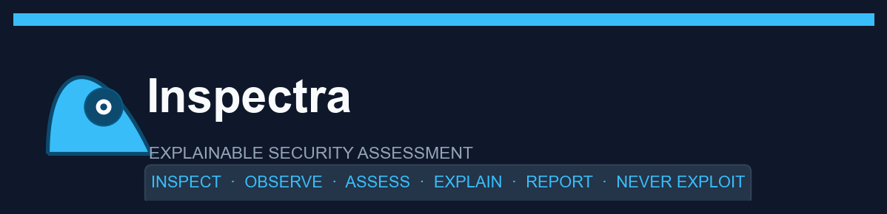
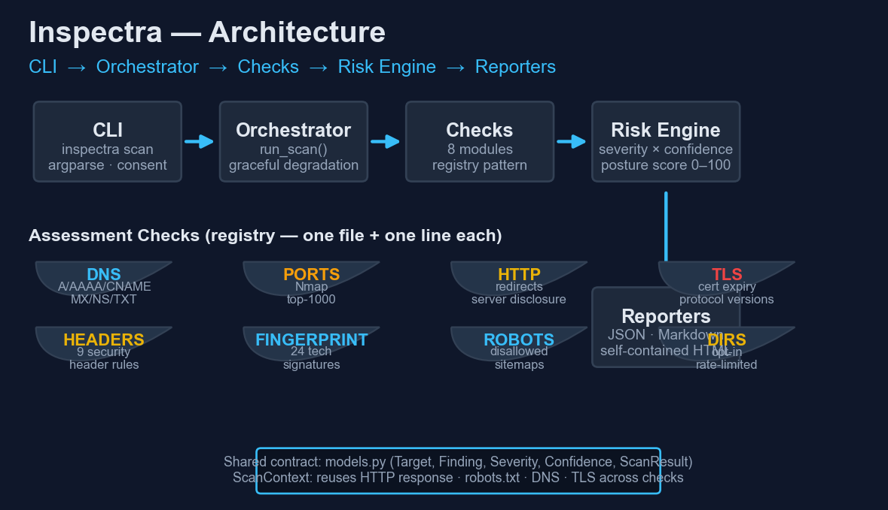
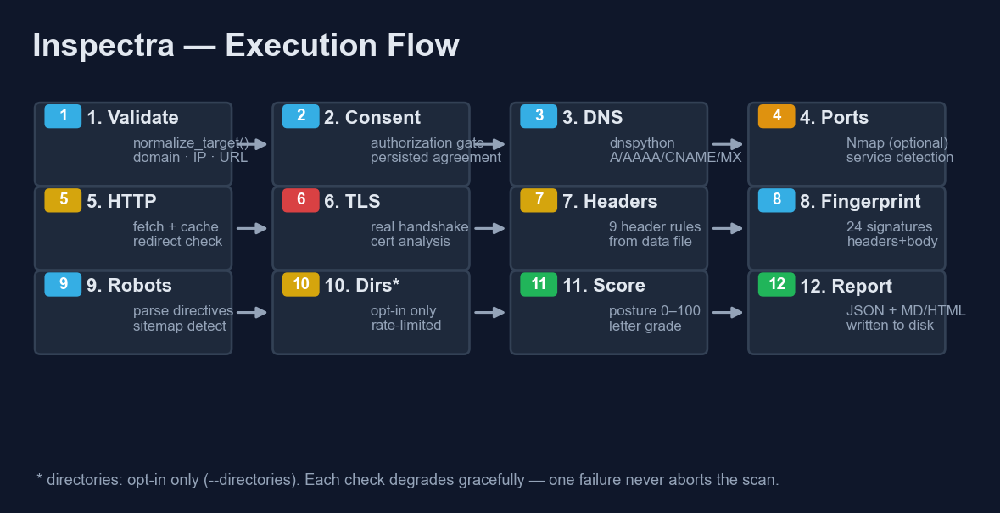
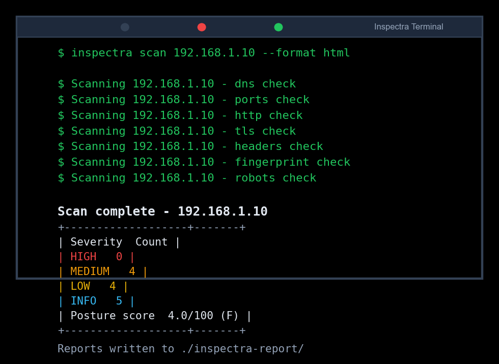
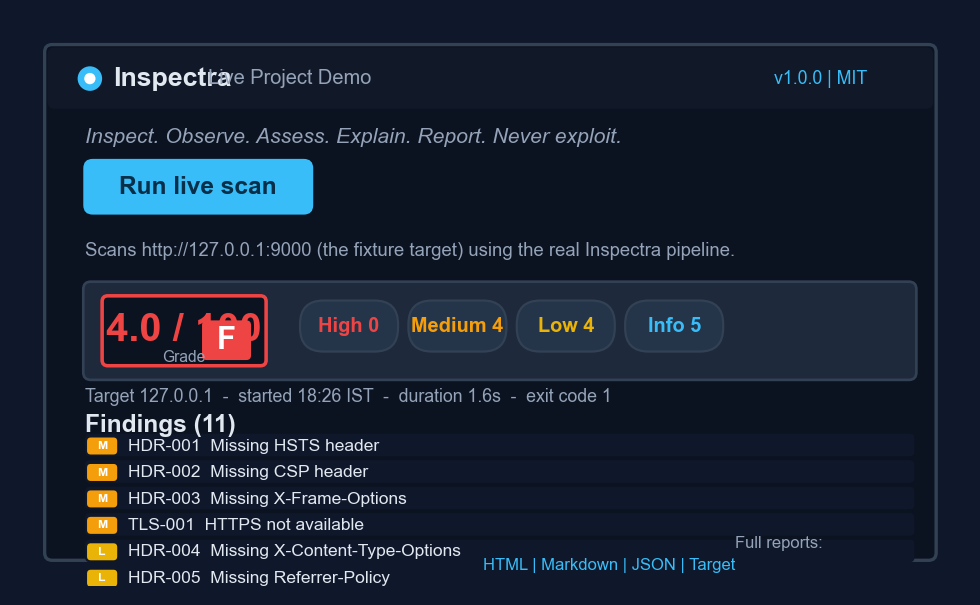
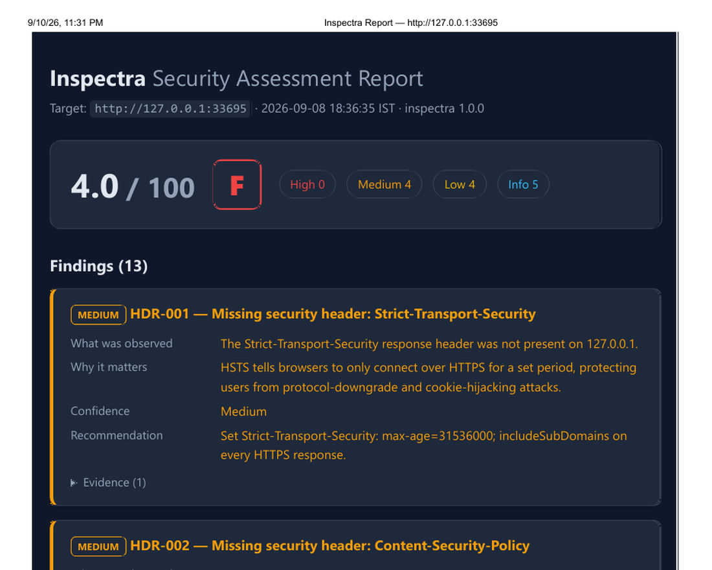
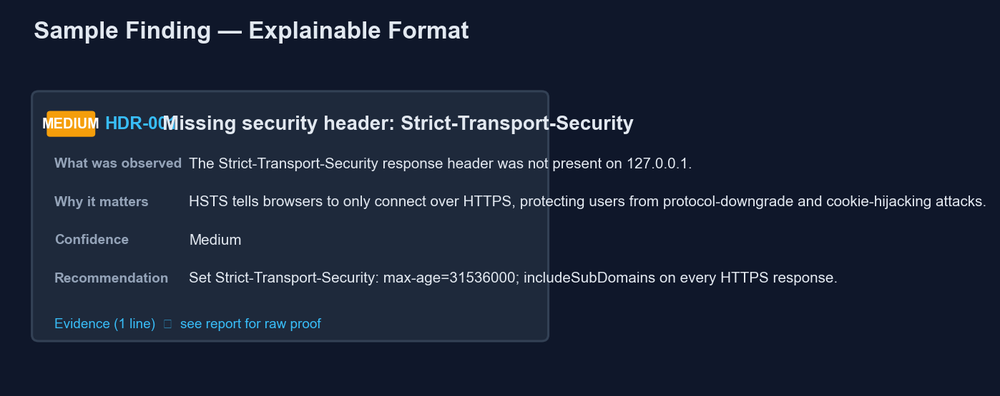
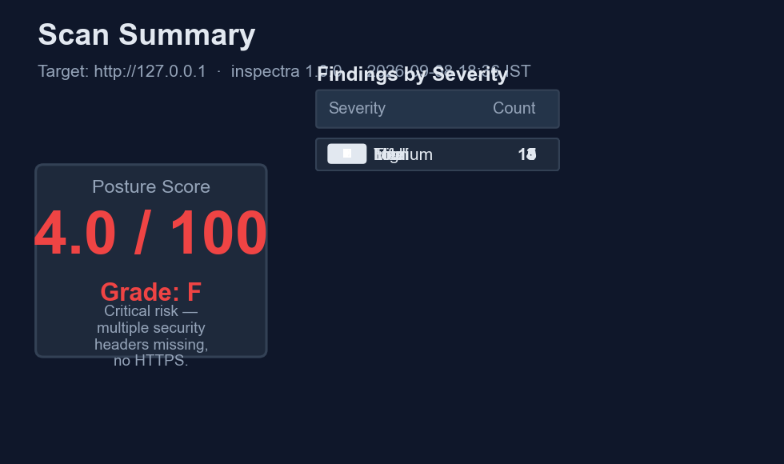
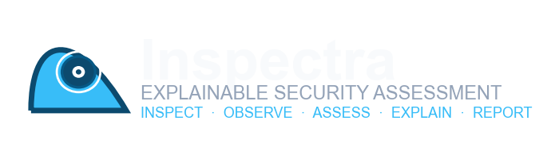

<div align="center">



**An Open-Source Explainable Security Assessment Framework**

*Inspect. Observe. Assess. Explain. Report. **Never exploit.**.*

</div>

[](.github/workflows/ci.yml)
[](pyproject.toml)
[](LICENSE)
[](pyproject.toml)
[](pyproject.toml)
[](SECURITY.md)

---

## ⚠️ Authorized Use Only

Inspectra is a **passive** assessment tool. It observes what a system willingly reveals and explains what it means. It never exploits, never brute-forces, and never sends attack payloads.

**Scan only systems you own or are explicitly authorized to test** — unauthorized scanning may be illegal in your jurisdiction.

See [docs/safety.md](docs/safety.md) for the full ethics and legal guidance.

---

This is **inspectra-cli**. An unrelated package named `inspectra` exists on PyPI (an AI code-review tool). Installing this project provides the `inspectra` and `inspectra-cli` commands.

---

## What Is Inspectra?

Inspectra is a single-command CLI tool that performs safe, passive security assessments on authorized targets and produces professional, **explainable** reports.

Most scanners dump raw technical output and leave you to interpret it. Inspectra is built around **explainability** — every finding answers:

| Question | Answer |
|----------|--------|
| **What was observed?** | The raw observation |
| **Why it matters** | The security reasoning, in plain language |
| **Evidence** | The data behind the observation |
| **Confidence** | How sure the tool is (low / medium / high) |
| **Severity** | Info / low / medium / high |
| **Recommendation** | A concrete next step |

On top of that, Inspectra computes a **posture score** (0–100 with a letter grade) so you can measure improvement: *scan → fix → re-scan → watch the score rise*.

**Built for:** students, junior security engineers, developers, small teams, home-lab users, and authorized training labs.

---

## Why Inspectra Exists

Security tooling is full of noise. A scan can return hundreds of lines of raw output and still tell you nothing about what you should actually *do*.

Inspectra takes the opposite approach:

- **Explain first, raw data second.** Every finding explains itself.
- **One command, no server to run.** `inspectra scan example.com` is the whole workflow.
- **Reports are the deliverable.** JSON for tooling, Markdown for reading, self-contained HTML for sharing.
- **Safe by design.** GET-only requests, timeouts everywhere, rate-limited opt-in directory checks, first-run authorization gate. No exploitation code anywhere in the codebase.

It is intentionally **not** an offensive tool, a brute-forcer, or a vulnerability database. It assesses what a target willingly exposes and explains what that means.

---

## Key Features (v1.0.0)

- ✅ Target validation with normalization (domain, IP, URL)
- ✅ First-run authorization gate, persisted consent
- ✅ DNS resolution & record analysis (A/AAAA/CNAME/MX/NS/TXT)
- ✅ Port discovery via Nmap (top-1000 default, `--ports` / `--skip-ports`)
- ✅ HTTP analysis: redirects, error states, server disclosure
- ✅ TLS verification: expiry, self-signed, hostname mismatch, protocol versions
- ✅ Security header assessment (9 rules: HSTS, CSP, X-Frame-Options, …)
- ✅ Technology fingerprinting (24 curated signatures)
- ✅ robots.txt inspection (disallowed paths, sitemaps)
- ✅ Opt-in directory observation (rate-limited, GET-only, curated wordlist)
- ✅ Evidence capture on every finding
- ✅ Risk engine: severity × confidence → posture score & grade
- ✅ Reports: **Markdown** (default), **HTML** (self-contained, polished), **JSON**
- ✅ Exit codes for CI: 0 clean · 1 findings · 2 error
- ✅ All report timestamps displayed in **Indian Standard Time** (IST, UTC+05:30)

---

## Architecture

Inspectra is a linear pipeline with a check registry — deliberately simple.

```
CLI  →  Orchestrator  →  Checks  →  Risk Engine  →  Reporters
```

<details>
<summary><strong>View architecture diagram</strong></summary>



</details>

**The layers:**

- **CLI** — `argparse` + Rich console. Parses arguments, shows the authorization gate, prints the summary, returns exit codes.
- **Orchestrator** — runs the registered checks in order with graceful degradation (one failed check never aborts the scan).
- **Checks** — eight independent modules sharing one data contract (`models.py`) and one `ScanContext` so later checks reuse earlier results instead of re-fetching.
- **Risk Engine** — applies the severity × confidence rubric and computes the posture score with letter grade.
- **Reporters** — three thin renderers (JSON, Markdown, self-contained HTML) over the same `ScanResult`.

The eight checks are: **dns · ports · http · tls · headers · fingerprint · robots · directories** (opt-in).

Adding a new check is one new file plus one registry line. See [CONTRIBUTING.md](CONTRIBUTING.md).

---

## Execution Flow

<details>
<summary><strong>View execution flow diagram</strong></summary>



</details>

1. **Validate** the target (domain, IP, or URL).
2. **Consent** — first-run authorization gate; remembered on disk; `--yes` skips the prompt.
3. Run checks in order: DNS → ports → HTTP → TLS → headers → fingerprint → robots → (directories, only if `--directories`).
4. Each check degrades gracefully. Only a fatal error (e.g. NXDOMAIN, Nmap missing) aborts the scan.
5. The risk engine scores findings by severity × confidence.
6. JSON (always) + Markdown or HTML reports are written; the console prints a summary.
7. Exit codes: `0` no actionable findings · `1` findings present · `2` error.

---

## Installation

```bash
pip install inspectra
```

From source:

```bash
git clone https://github.com/shashu123456/Inspectra.git
cd Inspectra
python -m venv .venv
.venv\Scripts\activate            # Windows
# source .venv/bin/activate       # macOS / Linux
pip install -e ".[dev]"
```

### Installing Nmap (recommended)

Port discovery uses [Nmap](https://nmap.org). Without it, run with `--skip-ports`.

| OS | Command |
|----|---------|
| Debian/Ubuntu | `sudo apt install nmap` |
| Fedora | `sudo dnf install nmap` |
| macOS | `brew install nmap` |
| Windows | [nmap.org/download.html](https://nmap.org/download.html) (enable "Add to PATH") |

---

## Quick Start

```bash
inspectra scan example.com --format html
```

The first run shows the authorization agreement (accepted once, then remembered). Reports land in `./inspectra-report/`:

```
inspectra-report/
├── report.html     (or report.md)
├── report.json
└── inspectra.log
```

All report timestamps are displayed in **Indian Standard Time** (`Asia/Kolkata`, UTC+05:30).

### Live Demo (no install needed to look around)

Run the included demo server locally:

```bash
.venv\Scripts\python demo\server.py
# then open http://127.0.0.1:9000/api/demo-page
```

The demo hosts a harmless, deliberately misconfigured fixture site and a page that runs **real Inspectra scans** against it, rendering findings in-browser with links to the full HTML/Markdown/JSON reports.

> The demo server and the static showcase in this README reflect the real tool — they are not mockups.

---

## CLI Examples

```bash
# Assess a website and get a polished HTML report
inspectra scan example.com --format html

# Assess a home-lab device with an explicit port list
inspectra scan 192.168.1.10:8443 --ports 80,443,8443

# Skip port discovery (no Nmap required)
inspheres scan example.com --skip-ports

# Opt-in directory observation with a custom wordlist
inspectra scan example.com --directories --directory-wordlist my-paths.txt

# Accept the authorization agreement without prompting (good for CI)
inspectra scan example.com --yes --format markdown

# Show the version
inspectra --version
```

### Example Console Output

```
$ inspectra scan example.com --yes --skip-ports --format html
Scan complete — example.com
┌───────────────┬───────┐
│ Severity      │ Count │
├───────────────┼───────┤
│ HIGH          │ 0     │
│ MEDIUM        │ 4     │
│ LOW           │ 4     │
│ INFO          │ 5     │
│ Posture score │ 4.0 / 100 (F) │
└───────────────┴───────┘
Reports written to …/inspectra-report
```

(This is the committed sample output from a deliberately misconfigured fixture site — hence the F grade. See the [Sample Reports](#sample-reports) section.)

---

## Output Formats

### JSON

Always written. Machine-readable, stable schema, timezone-safe (`started_at` in UTC ISO-8601, `started_at_ist` for display).

### Markdown

Default human-readable format. Findings with severity headers, summary table, posture score, and scan metadata.

### HTML

Self-contained, polished report with inline CSS — no external assets, no network calls. Opens directly in any browser.

---

## Screenshots

### CLI Demo



### Live Demo Page



### Sample HTML Report



### Sample Findings



### Report Summary



---

## Sample Reports

Production-quality sample reports are committed under [`examples/sample-report/`](examples/sample-report/):

| File | Purpose |
|------|---------|
| [`report.md`](examples/sample-report/report.md) | Markdown report (default format) |
| [`report.html`](examples/sample-report/report.html) | Self-contained HTML report |
| [`report.json`](examples/sample-report/report.json) | Machine-readable JSON report |

A copy is also generated locally under [`sample-output/`](sample-output/) when you run the sample-report script.

The sample target is a deliberately misconfigured fixture site — the posture score is a low **4.0 / 100 (F)** by design, so the reports demonstrate how Inspectra surfaces real issues.

---

## Project Logo

<div align="center">



</div>

A scalable vector version is available at [`docs/assets/logo.svg`](docs/assets/logo.svg).

---

## Project Layout

```
Inspectra/
├── src/inspectra/              # the tool — one package, one responsibility per file
│   ├── cli.py                  # argparse, consent gate, exit codes
│   ├── orchestrator.py         # runs checks, builds ScanResult
│   ├── models.py               # Target / Finding / Severity / Confidence / ScanResult
│   ├── network.py              # httpx client + TLS inspection
│   ├── checks/                 # 8 assessment modules + registry
│   ├── analysis/               # risk engine + recommendation helpers
│   ├── report/                 # json / markdown / html renderers
│   └── data/                   # versioned rules, fingerprints, wordlist
├── tests/                      # pytest suite (local fixture server, no internet)
├── demo/                       # live demo: fixture site + in-browser scan UI
├── docs/                       # architecture, usage, safety, roadmap
│   └── assets/                 # logos, diagrams, screenshots
├── examples/sample-report/     # committed sample output (md + html + json)
├── sample-output/              # locally generated sample reports (gitignored)
└── scripts/                    # report-regeneration helper
```

---

## Technologies

| Technology | Role |
|------------|------|
| [Python 3.11+](https://www.python.org/) | Runtime |
| [httpx](https://www.python-httpx.org/) | HTTP client — timeouts, redirect control |
| [dnspython](https://www.dnspython.org/) | DNS record resolution |
| [python-nmap](https://pypi.org/project/python-nmap/) | Nmap integration for port discovery |
| [cryptography](https://cryptography.io/) | X.509 certificate parsing |
| [rich](https://rich.readthedocs.io/) | Terminal UI — progress, colours, summary tables |
| [Jinja2](https://jinja.palletsprojects.com/) | HTML report templating |
| [pytest](https://pytest.org/) · [mypy](https://mypy.readthedocs.io/) · [ruff](https://ruff.rs/) | Tests, strict type checking, lint + format |

---

## Quality

| Check | Result |
|-------|--------|
| Lint (ruff) | ✅ clean |
| Format (ruff) | ✅ clean |
| Type check (mypy) | ✅ strict, `src/` only |
| Tests (pytest) | ✅ 91 tests, ~90% coverage |
| CI | ✅ GitHub Actions on Python 3.11 / 3.12 |

The test suite runs against a local fixture server — it never touches the internet. Nmap is **not** required for tests or the demo (`--skip-ports`).

---

## Documentation

| Document | Purpose |
|----------|---------|
| [docs/architecture.md](docs/architecture.md) | Single source of truth for the design |
| [docs/usage.md](docs/usage.md) | CLI reference, options, examples |
| [docs/safety.md](docs/safety.md) | Ethics, legal guidance, authorized-use checklist |
| [docs/roadmap.md](docs/roadmap.md) | Release history and future direction (planning only) |
| [CHANGELOG.md](CHANGELOG.md) | Notable changes per release |
| [CONTRIBUTING.md](CONTRIBUTING.md) | How to add a check |

---

## Live Demo & Static Showcase

A live, interactive demo is built into the project:

- **Local demo server:** `.venv\Scripts\python demo\server.py` → `http://127.0.0.1:9000/api/demo-page`
- The demo page runs **real scans** against a harmless fixture site and renders findings in-browser.

To make the project browsable without installing anything, this repository also ships a **static showcase** rendered directly from the real tool's output. The diagrams, screenshots, and sample reports in this README are generated from the actual code — they are not mockups.

---

## Roadmap

V1 is feature-frozen by design. Every future idea lives in [`docs/roadmap.md`](docs/roadmap.md) — nothing from the roadmap is committed until it goes through a design review.

V2 candidates include: an async engine, a plugin system for third-party checks, cookie/CORS audits, passive subdomain enumeration via certificate transparency, and a read-only web dashboard over the existing `report.json` schema.

The project's founding promise applies to every future version: **observe, assess, explain, report — never exploit.**

---

## Contributing

Contributions are welcome. The project follows one rule above all others:

> **Inspect. Observe. Assess. Explain. Report. Never exploit.**

Any contribution that adds exploitation, brute-forcing, payload delivery, or attack tooling will be declined, no matter how well implemented.

See [CONTRIBUTING.md](CONTRIBUTING.md) for the full guide — including how to add a new check (it is deliberately small).

Use the issue templates for bug reports, feature requests, and new check proposals.

---

## Security Policy

If you discover a security vulnerability **in Inspectra itself**, please report it responsibly:

1. **Do not** open a public issue for security problems.
2. Use GitHub's **"Report a vulnerability"** (Security → Advisories) so the report stays private.
3. Include reproduction steps, affected version, and impact assessment.

See [SECURITY.md](SECURITY.md) for the full policy, supported versions, scope, and safe harbor statement.

---

## License

[MIT](LICENSE) — © 2026 Inspectra contributors.

---

## Disclaimer

Inspectra is provided **"as is"**, without warranty of any kind. You are solely responsible for ensuring your use of the tool is legal and authorized. The authors and contributors are not liable for misuse.
