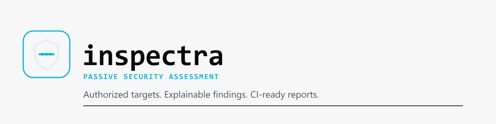
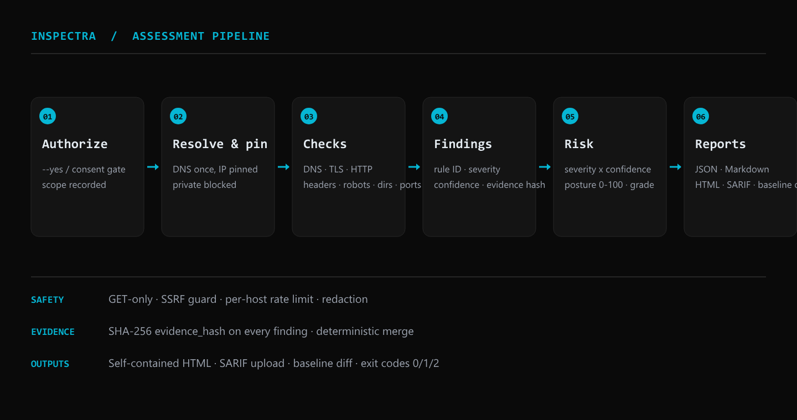

[](https://github.com/shashu123456/Inspectra/actions/workflows/ci.yml)
[](https://pypi.org/project/inspectra-cli/)
[](https://www.python.org/)
[](https://github.com/shashu123456/Inspectra/blob/main/LICENSE)

Inspectra is a passive, explainable security assessment CLI for systems you own or are explicitly authorized to test. One command produces a posture score, rule-ID findings with evidence hashes, and reports in JSON, Markdown, HTML and SARIF. It never sends payloads and never exploits.

## Install

```bash
pip install inspectra-cli
```

## Run a scan

```bash
inspectra scan http://127.0.0.1:8001 --yes --skip-ports --allow-private --authorized --format html
```

Open `inspectra-report/report.html`. A live, recorded sample report is available on the [project site](https://shashu123456.github.io/Inspectra/).

## Example output

```text
Target   http://127.0.0.1:8001
Posture  61.6 / 100 - D
Summary  3 findings · 0 high · 2 medium · 0 low · 1 info

medium  HDR-001  Missing security header: Strict-Transport-Security
info    HTP-003  Web server software disclosed (with version)
medium  TLS-001  HTTPS not available

Reports written to inspectra-report
```

Every finding carries a rule ID, severity, confidence, evidence, why it matters, a recommendation, a fingerprint and a SHA-256 `evidence_hash`. See the [sample JSON report](https://github.com/shashu123456/Inspectra/blob/main/docs/reports/target1.json).

## What it checks

| Area | Rule prefix | What it looks for |
|------|-------------|-------------------|
| DNS | `DNS-` | Resolution and IP pinning |
| TLS | `TLS-` | Certificate expiry, self-signed, protocol versions |
| HTTP | `HTP-` | Server disclosure, error states, redirects |
| Headers | `HDR-` | Missing or weak security headers |
| Robots | `ROB-` | Disallowed paths in `robots.txt` |
| Directories | `DIR-` | Exposed common paths (opt-in) |
| Ports | `PRT-` | Open ports from Nmap (optional) |
| Fingerprint | `FPR-` | Technology signals from cached responses |

## How it works



1. **Authorize** — `--yes` or a persisted consent gate records the scope.
2. **Resolve and pin** — DNS is resolved once; the IP is pinned; private targets require `--allow-private`.
3. **Run checks** — bounded concurrency with per-host rate limiting; the primary response is cached and reused.
4. **Build findings** — each finding is normalized with a rule ID, severity, confidence, evidence and evidence hash.
5. **Score risk** — severity × confidence drives the 0–100 posture score and letter grade.
6. **Write reports** — JSON, Markdown, HTML or SARIF, with optional baseline diffing.

Full detail: [docs/architecture.md](https://github.com/shashu123456/Inspectra/blob/main/docs/architecture.md).

## Results

| Metric | Result |
|--------|--------|
| In-scope recall | **49/49 (100%)** across 8 measured lab targets |
| Precision | **100%** — 0 unexplained false positives; 9 justified absences documented |
| Determinism | Identical findings across 3 runs per target |
| Test suite | **220 tests passed, 89% coverage** |
| Current release | `inspectra-cli` v2.3.6 |

Four additional lab targets are present but **not measured on this platform** (TLS handshake and path fixtures are unreliable on Windows). Nothing is claimed for them. See [docs/accuracy.md](https://github.com/shashu123456/Inspectra/blob/main/docs/accuracy.md) and the full [results page](https://github.com/shashu123456/Inspectra/blob/main/docs/RESULTS.md).

## Reports

| Format | Flag | Use |
|--------|------|-----|
| JSON | `--format json` | Stable, machine-readable schema |
| Markdown | `--format markdown` | Human-readable report |
| HTML | `--format html` | Self-contained, shareable report |
| SARIF | `--format sarif` | CI and code-scanning upload |

## Use in CI

```yaml
- run: inspectra scan https://example.com --yes --skip-ports --format sarif -o inspectra.sarif --fail-on high
- uses: github/codeql-action/upload-sarif@v3
  with:
    sarif_file: inspectra.sarif
```

## Baselines

```bash
inspectra scan https://example.com --yes --skip-ports --save-baseline baseline.json
inspectra scan https://example.com --yes --skip-ports --baseline baseline.json --fail-on high
```

Fail the run when new findings appear; unchanged findings stay quiet.

## Safety and scope

- GET-only requests, no payloads, no exploitation.
- SSRF guard: DNS resolved once, IP pinned, private ranges blocked by default.
- Consent gate required before any scan; `--yes` is an explicit acknowledgement.
- Secrets and header values are redacted before serialization.
- Missing Nmap degrades gracefully; it is not a fatal error.

Out of scope: exploitation, credential cracking, vulnerability chaining, authentication bypass and unauthorized targets. See [THREAT_MODEL.md](https://github.com/shashu123456/Inspectra/blob/main/THREAT_MODEL.md).

## Proof

- [Results and sample output](https://github.com/shashu123456/Inspectra/blob/main/docs/RESULTS.md)
- [Accuracy benchmark](https://github.com/shashu123456/Inspectra/blob/main/docs/accuracy.md)
- [Evidence log](https://github.com/shashu123456/Inspectra/blob/main/docs/EVIDENCE.md)
- [Live sample report](https://shashu123456.github.io/Inspectra/)
- [CI workflow](https://github.com/shashu123456/Inspectra/blob/main/.github/workflows/ci.yml)

## Contributing

Contributions are welcome. Start with [CONTRIBUTING.md](https://github.com/shashu123456/Inspectra/blob/main/CONTRIBUTING.md).

## License

[MIT](https://github.com/shashu123456/Inspectra/blob/main/LICENSE) — © 2026 Inspectra contributors.
