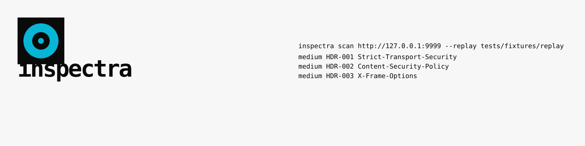

<div align="center">


</div>

Passive security assessment for authorized targets.
One command. Deterministic findings. SARIF for CI.



## Install

```bash
pip install inspectra-cli
inspectra --version
inspectra scan http://127.0.0.1:9999 --yes --skip-ports --allow-private --authorized --format html
```

## What you get

| Severity | Rule | Title | Fix |
|----------|------|-------|-----|
| medium | HDR-001 | Missing security header: Strict-Transport-Security | Add `Strict-Transport-Security` header |
| medium | HDR-002 | Missing security header: Content-Security-Policy | Add `Content-Security-Policy` header |
| medium | HDR-003 | Missing security header: X-Frame-Options | Add `X-Frame-Options` header |
| low | HDR-004 | Missing security header: X-Content-Type-Options | Add `X-Content-Type-Options: nosniff` |

The scan assigns a posture score (0–100) with a letter grade (A+–F) so you can track improvement across runs.

## How it works


1. **Safety gate** — DNS resolved once, IP pinned; private IPs blocked unless `--authorized`.
2. **Checks** — DNS, TLS, HTTP, headers, robots, directories, ports, fingerprint run with per-host politeness.
3. **Findings** — each check emits rule-id, severity, title, evidence, and `evidence_hash`.
4. **Risk** — severity × confidence → posture score (0–100) with letter grade.
5. **Report** — JSON, Markdown, HTML, or SARIF output; optional baseline diff.

## Output formats

| Format | Flag | What it's for |
|--------|------|-------------|
| JSON | `--format json` | Machine-readable, stable schema |
| Markdown | `--format markdown` | Human-readable, default |
| HTML | `--format html` | Self-contained, polished report |
| SARIF | `--format sarif` | CI pipelines, GitHub Code Scanning |

## Use it in CI

```yaml
- run: inspectra scan http://127.0.0.1:9999 --yes --skip-ports --allow-private --authorized --format sarif -o inspectra.sarif
- uses: github/codeql-action/upload-sarif@v3
  with: { sarif_file: inspectra.sarif }
```
`--fail-on` exits non-zero only when new findings appear versus a saved baseline.

## Baselines

```bash
inspectra scan http://127.0.0.1:9999 --yes --skip-ports --allow-private --authorized --save-baseline baseline.json
inspectra scan http://127.0.0.1:9999 --yes --skip-ports --allow-private --authorized --baseline baseline.json --fail-on new
```
Compare two scans and fail the run when new findings appear.

## Safety model

- SSRF blocking — DNS resolved once, IP pinned; private/loopback/CGNAT addresses blocked unless `--allow-private --authorized`.
- `--authorized` consent — required before any scan runs; persisted on disk.
- Redaction — secrets, JWTs, and header values redacted before any report serializes (`--no-redact` to disable).
- evidence_hash — SHA-256 of each finding's evidence, stored on every finding and in SARIF.

See [THREAT_MODEL.md](THREAT_MODEL.md).

## Benchmark

| Mode | Runs | Avg wall (s) | Findings | Identical? | False positives |
|------|------|--------------|----------|------------|-----------------|
| Serial (`--concurrency 1 --delay 0`) | 5 | 0.103 | 9 | yes | 0 |
| Concurrent (`--concurrency 8 --delay 0`) | 5 | 0.023 | 9 | yes | 0 |

Measured on committed replay fixtures (no network — report assembly only, not network politeness or real-target wall time). See [docs/benchmark.md](docs/benchmark.md).

## Scope

| Not supported | Why |
|---------------|-----|
| Exploitation / payload delivery | Tool is passive: GET-only, no attack payloads |
| Credential cracking / fuzzing | Out of scope for a passive scanner |
| Vulnerability chaining | Findings are reported, not chained into attacks |
| Scanning unauthorized targets | `--authorized` consent gate is required |
| Authentication bypass | Tool observes what a target willingly exposes |
| Active attack simulation | Reports configuration weaknesses only |

## Contributing / License

Contributions are welcome. See [CONTRIBUTING.md](CONTRIBUTING.md). [MIT](LICENSE) — © 2026 Inspectra contributors.
